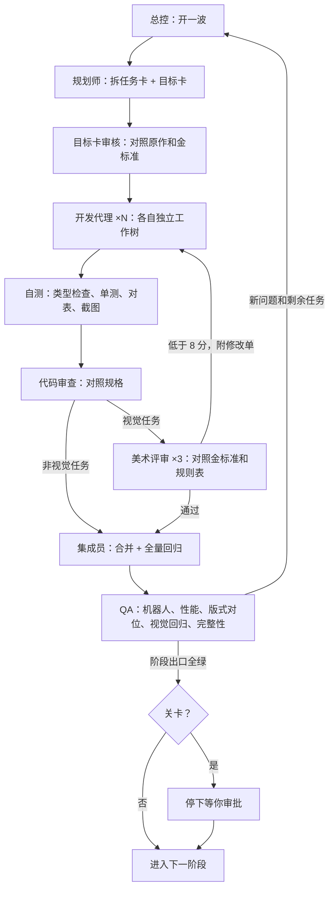

# 《棺材板下》自动化工作室方案 v3（已确认，2026-10-22）

2026-10-22 · 取代 `方案-v2-全自动生产.md` 中的美术与流程部分。v2 的逆向成果、工具链和阶段思路保留。

## 0. 一句话目标

把《回弹深渊》Demo 1:1 复刻成 H5 游戏（Three.js / WebGL2）：

- **照原作**：玩法、规则、算法、数值、界面布局、内容数量。
- **换成我们的**：画面、角色、世界观、界面风格、音频。

---

## 1. 我们对任务目标的理解（请逐条确认）

### 1.1 照原作复刻，一处都不改

| 类别 | 内容 | 来源（逆向已拿到） |
|---|---|---|
| 弹射与碰撞 | 每段固定距离、碰到墙或敌人就重置；扫描步长、反弹分离、反弹上限、每次反弹提速、末段滑行、停止判定 | 原生代码反汇编 + `native-trajectory` / `launch-movement` 规格草稿 |
| 瞄准预览 | 每段一条箭头线；段末标记（敌人：虚线圈；墙：点加弧线；无接触：点）；末段短线 | `trajectory-preview` 草稿、`碰撞预览圈` 蓝图 |
| 回合与战斗 | 回合流程、伤害、暴击、弱点、护盾、格挡、闪避、易伤、持续伤害、治疗 | 793 个蓝图、5240 个函数 |
| 资源 | 体力（每回合 −5）、腐化（代码里是体力 ≤ 0 时随机 +1~2）、物品充能（满 100 一次）、灌注、回响 | 同上 |
| 评级 | 每回合 D–SSS 评级和统计 | 同上 |
| 敌人 | AI、意图、技能、数值 | `数据表_敌人_普通` 等 |
| 单局 | 地图与房间生成、掉落、合成、附魔、天赋、诅咒与深渊等级 | 49 张数据表（2546 行）、55 条曲线 |
| 局外 | 营地、神像、任务、新手关、结算（出殡弹珠）、存档、设置 | 同上 |
| 界面布局 | 112 个界面的控件位置、尺寸、层级和交互流程（原稿 1920×1080） | 界面导出 |
| 内容数量 | 4 名英雄、约 17 种敌人 + 3 个首领、202 件物品、586 条技能、147 条天赋、83 条图鉴、26 个固定地点 | 数据表行数 |

### 1.2 换成我们的

- **画面**：今天你认可的 3D 像素墓室（见第 2 节），这是唯一的画面标准。
- **角色**：
  - 甲壳虫骑士替换原作初始英雄「幽冥骑士」，技能和数值照搬幽冥骑士。
  - 另外 3 名英雄、全部敌人和首领重新设计：每个原作角色对应一个我们的角色，机制不变。设计在 G3 关卡交你审。
- **世界观与命名（草案，G3 一起定）**：
  - 「笑面圣会」占据了地下礼拜堂，信徒相信笑着死去就能成圣。
  - 甲壳虫骑士是唯一不笑的人，被扔进深渊，靠一身甲壳一次次弹回来。
  - 名字和风味文案换成我们的。规则说明里的数字和机制与原作一致，中英双语。
- **界面风格**：
  - 不用金色主导。金色只允许极少量点缀，也可以完全不用。
  - 可以是像素风。
  - 布局 1:1 照原作，只换皮。
  - 先出 3 版给你选（G1）。
- **音频**：程序化合成（WebAudio），不用外部音频文件。

### 1.3 不做、不碰

- **不加原作没有的系统。** 好点子先写成提案给你，批了才做。
- **画面禁区**：
  - 满屏辉光（v2 的光污染）。
  - 过重的噪点抖动。
  - 虫子的恶心细节：腿、触角、口器。骑士的甲虫元素只出现在盔甲上。
  - 血腥。
  - 金色主导的界面。
  - 高清平涂的"玩具感"（风格 B 被否的原因）。
- **对外动作**：不对外发布或部署，不动工作目录以外的文件，不花模型以外的钱。

---

## 2. 已锁定的美术基线（所有视觉任务唯一的对照标准）

### 2.1 金标准画面

今天你认可的这一版存进 `studio/golden/`，作为对照基准：

- 放大战斗画面
- 瞄准画面
- 击杀瞬间
- 角色表
- 一次完整回合的动图

代码基线是 `task/art-p` 分支（W0 合进主干）。

### 2.2 规则表（ART_BIBLE v3，一页纸，取代旧美术圣经里冲突的部分）

1. **像素**：
   - 内部 960×540，每格 24 像素，整数放大。
   - 原作的俯视斜投影：地面方格是正方形，高度按 0.625 压缩。
   - 抖动全局 × 0.45，画面要干净。
2. **三方一眼分清**：
   - 主角：白、金、蓝，暖金色描边，身边带一团暖光。
   - 敌人：血红、骨白、黑，红色描边，眼睛在烧，脚下有一圈红光。
   - 背景：压暗、降饱和，霉菌只长在墙角。
3. **光源只有三类**：彩窗、烛台、角色自带的小光。
4. **小怪**：
   - 个头不小于主角，始终盯着主角、身体前探。
   - 咧嘴有牙，有一处"不对劲"的细节。
   - 可爱的比例，不恶心。
5. **尺寸**：英雄碰撞半径 0.875 格（原作 56 单位）。球形态画面半径 0.76 格。
6. **界面**：
   - 像素风可以，配色由 G1 决定。
   - 预览、标记、伤害数字画在 960×540 网格上，保持像素清晰。

### 2.3 评审只对照金标准和规则表打分

取消"越疯狂越好"的升级环节。v2 里每阶段都有一轮"疯狂加码"，这是风格越跑越偏的主要原因之一。

---

## 3. 防跑偏机制（这次的重点）

| # | 机制 | 解决什么 |
|---|---|---|
| 1 | **目标卡**：每个任务开工前先写一张。内容包括：复刻原作哪一块（数据和蓝图路径）、验收测试、对照哪张金标准画面、禁区清单。审查员先审目标卡，再审代码。 | 代理没理解任务就开工 |
| 2 | **两个真相源**：规则只认核对过的规格书，画面只认金标准加规则表。 | 凭感觉自由发挥 |
| 3 | **规格先行**：规格书过对抗核对、配齐测试向量之后才允许实现，实现必须通过对表测试。 | 机制和原作不一致 |
| 4 | **你的审批关卡（阻塞）**：G1 界面风格、G2 垂直切片、G3 全角色设计、G4 单局流程、G5 终验。关卡之间全自动，到关卡停下等你。 | 方向错了很久才发现 |
| 5 | **视觉回归**：每波截图对比金标准，色相、亮度分布、像素密度、描边颜色偏了就自动报警，交美术评审确认。 | 风格慢慢漂移 |
| 6 | **提案池**：代理的新想法只写提案，不直接做；我汇总，你批了才排进任务。 | 自作主张 |
| 7 | **我不替你拍板**：涉及审美方向的选择都带图问你。技术实现的选择由我定，并在汇报里说明。 | 上几轮我做了太多主观决定 |
| 8 | **预算闸**：每天上限 $1200（给你自己留 $300），到了自动暂停；每波结束汇报。 | 第一天撞到 $1500 日上限 |

---

## 4. 工作室怎么运转

沿用你截图里那套流程，加了"目标卡审核"和"关卡审批"两步：

- **模型**：全程 Opus 5.5。
- **并发**：8–12 个子代理，本机上限 16，留余量给构建和浏览器。
- **状态落盘**：`studio/STATE.json`、`BOARD.md`、`reports/`。上下文压缩或会话中断后，用 runId 续跑。
- **汇报**：每波结束在对话里用中文简报，附 1–3 张截图；到关卡时出完整审阅包（截图、动图、可玩的单文件 H5）。

---

## 5. 阶段路线

| 阶段 | 内容 | 出口标准 | 关卡 | 估计 |
|---|---|---|---|---|
| **W0 地基收口** | 1. `task/art-p` 合进主干。 2. 清掉作废的代码：美漫渲染器、西瓜虫、高清辉光分支。 3. 存金标准画面，写 ART_BIBLE v3 和文件所有权 v3。 4. 工具：截图、性能、对表、机器人、视觉回归。 5. 3 版界面风格效果图：同一张战斗界面，按原作布局，都不用金色。 | 主干能跑；工具可用 | **G1 你选界面风格** | ½ 天 |
| **P0 规格补全与核对**（和 W0 并行） | 1. 70 份规格：17 份草稿做核对，53 份新写。 2. 每份由 2 名核对员对抗式挑错。 3. 测试向量 ≥ 300 条。 4. 弹射原生代码的 1:1 移植规格配好测试向量。 | 规格齐全、核对通过，未知项清单写明 | — | 1–1.5 天 |
| **P2 垂直切片** | 1. 原作第一场战斗完整可玩。 2. 弹射和碰撞内核 1:1 移植。 3. 回合、体力、腐化、伤害、暴击、弱点、充能。 4. 3 种敌人的 AI 和意图；评级统计。 5. 战斗界面（G1 选定的风格，布局 1:1）。 6. 全套打击感。 | 对表全绿；60fps；美术评审通过 | **G2 你试玩** | 1–1.5 天 |
| **P3 全角色设计** | 1. 写出原作角色到我们角色的对应表。 2. 4 名英雄、约 17 种敌人、3 个首领出引擎内设计图：正侧背、关键动作、和骑士同框的比例。 3. 世界观和命名定稿。 | 设计图齐全 | **G3 你审全部角色** | 1 天 |
| **P4 战斗全量** | 1. 全部技能、效果、状态。 2. 全部敌人和首领：模型、动画、AI。 3. 首领房、场地机关。 | 战斗相关测试向量 100% 通过 | — | 1.5–2 天 |
| **P5 构筑与单局** | 1. 202 件物品：模型、图标、效果、测试。 2. 品质、合成、附魔、分解；掉落池。 3. 地图生成；商人、营火、铁砧、神像、事件。 4. 天赋、诅咒、深渊等级。 5. 从开局打到首领。 | 能从开局打到首领；数值对表通过 | **G4 你试玩一整局** | 2 天 |
| **P6 局外与营地** | 营地、英雄选择、神像、制造、仓库、潜能、图鉴、成就、新手关、出殡弹珠结算、存档、设置、中英本地化 | Demo 全部界面就位 | — | 1.5 天 |
| **P7 打磨与验收** | 程序化音频、画质三档与手机适配、1000 局机器人回归、数值逐条对表、全部界面终审 | 第 6 节全部满足 | **G5 终验** | 1 天 |

**规模**：

- 合计约 9–11 天的自动运行，不含你审批等待的时间。
- 子代理任务约 500–700 次（含返工），约 1.5 亿 token。
- 按第一天的实际单价（约 $52 / 百万 token）算，总计约 $7,000–9,000，按每天不超过 $1200 分摊。

---

## 6. 什么叫"做完"（全部满足才算）

1. **内容齐全**：Demo 能玩到的界面、系统、内容全部就位。
2. **数值一致**：和原作导出表逐条一致，对表测试 100% 通过；有例外的写明原因。
3. **全流程可通**：新手关 → 营地 → 冒险 → 击败首领 → 结算 → 回营地，存档可续。
4. **稳定性**：1000 局机器人对局，0 崩溃、0 卡死。
5. **性能**：PC 1080p 稳定 60fps；中端手机开低档画质 ≥ 30fps。
6. **画面**：全部画面和界面都过美术评审，并且通过对金标准的视觉回归。
7. **交付**：单文件 H5 包，加一个可本地运行的网页版。

---

## 7. 需要你确认的（都有默认值）

1. **任务目标**：第 1 节的理解准不准？有没有漏掉或理解错的地方？
2. **命名与文案**：默认名字和风味文案换成我们的，规则文字的数字和机制与原作一致，中英双语。
3. **首个英雄**：甲壳虫骑士 = 原作「幽冥骑士」换皮，技能和数值照搬。
4. **预算与节奏**：每天不超过 $1200，约 9–11 天，总计约 $7,000–9,000。
5. **审批方式**：G1–G5 停下等你；关卡之间不打扰你，只在对话里简报。
6. **界面配色倾向**（G1 会出图让你选，也可以现在先说倾向）：
   - A「墨与骨」：近黑底板，骨白像素线和字。红色只给危险和敌人，蓝色只给主角的资源。像一本用两种墨水印的教团手抄本。
   - B「蜡封羊皮」：暗色皮革和羊皮纸底板，红蜡封当按钮，墨色字，烛光暖色高亮。
   - C「冷铁与烛」：冷灰蓝的铁框加铆钉，只有当前可操作的元素用烛火橙。
7. **工作名**：继续用《棺材板下》？

---

## 8. 风险与兜底

| 风险 | 兜底 |
|---|---|
| 规格草稿没核对过，可能有错 | P0 先核对再实现；有分歧以导出数据和反汇编为准 |
| 弹射原生代码只有反汇编 | 按反汇编逐条移植，配测试向量；对不上的列进未知项清单 |
| 审美主观 | 金标准画面 + 规则表 + 视觉回归 + 5 个审批关卡 |
| 并行改代码冲突 | 独立工作树 + 文件所有权表 + 集成员按依赖顺序合并 |
| 预算撞上限，影响你自己用 | 每天上限 $1200，到线自动暂停 |
| 长时间运行中断 | 状态落盘，runId 续跑，任务可重复执行 |

## 9. 确认结果（2026-10-22）

1. **任务目标**：第 1 节基本准确。
2. **世界观**：一个被腐蚀的菌类世界，玩家扮演甲壳虫骑士下地牢探险。
   - 美术上的对应：青绿色的菌是这个世界本身；血红色是腐蚀，被腐蚀的生物咧嘴、眼睛燃烧，也就是敌人。
   - 具体角色和命名在 G3 定。
3. **首个英雄**：甲壳虫骑士 = 原作「幽冥骑士」换皮。
4. **预算**：不限。
   - 账号本身有每天约 $1500 的硬上限，到了会暂停，北京时间 8 点重置后续跑。
5. **界面**：A「墨与骨」。近黑底板配骨白像素线，红色只给敌人和危险，蓝色只给主角资源。
6. **审核方式**：每到一个重要节点，直接发可玩的链接加 GIF，制作方觉得不错才继续往下做。
   - 链接：私有的 XD Sites 预览站，每个关卡更新一次。
